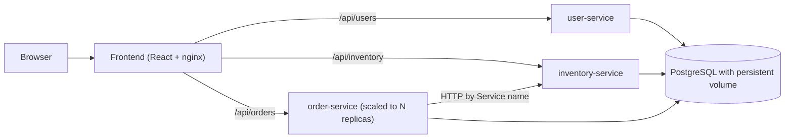
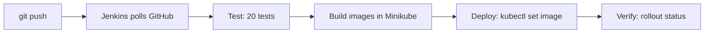

# Kube Kitchen: Cloud-Native Online Food Ordering System

A food ordering app built as separate microservices, packaged in Docker containers and deployed on Kubernetes, with a Jenkins CI/CD pipeline.

## Features

- **Customers:** register, log in, browse restaurants and categories, search, add dishes to a cart, apply promo codes, place orders and track delivery.
- **Restaurant owners:** a separate admin console with a live dashboard (orders, revenue, stock alerts), inventory management, and a service-health and load-balancing panel.
- **Two roles with separate logins.** Owner registration needs a secret access code.

## Architecture



| Component | Technology | Purpose |
|---|---|---|
| frontend | React (Vite) served by nginx | Customer store and owner admin console |
| user-service | FastAPI | Register, login, roles (passwords hashed with bcrypt) |
| inventory-service | FastAPI | Menu, stock, stock reservation |
| order-service | FastAPI | Places orders, calls inventory-service by Kubernetes Service name |
| database | PostgreSQL, one database per service | Data persists on a PersistentVolumeClaim |
| orchestration | Kubernetes (Minikube) | Service discovery, load balancing, self-healing, rolling updates |
| CI/CD | Jenkins | Test, build, deploy, verify on every push |

## Project structure

```
services/
  user-service/        FastAPI service, Dockerfile, tests
  inventory-service/   FastAPI service, Dockerfile, tests
  order-service/       FastAPI service, Dockerfile, tests
frontend/              React app, nginx.conf, Dockerfile
k8s/                   Kubernetes manifests
init-db/               SQL that creates the three databases
docker-compose.yml     Run everything locally without Kubernetes
Jenkinsfile            CI/CD pipeline
```

## Run it on Kubernetes (Minikube)

Requirements: Docker Desktop, Minikube, kubectl.

```
git clone https://github.com/mmanyashreebv-cpu/food-ordering.git
cd food-ordering
minikube start --driver=docker
kubectl create namespace food
```

Create the owner access code. It is stored in a Kubernetes Secret and is never committed to Git. Choose your own value:

```
kubectl create secret generic owner-secret --from-literal=OWNER_CODE=choose-a-code -n food
```

Build the images inside Minikube (no registry is used). Use the tag shown on the `image:` line of each manifest in `k8s/`; for example:

```
minikube image build -t user-service:v3 services/user-service
minikube image build -t inventory-service:v1 services/inventory-service
minikube image build -t order-service:v1 services/order-service
minikube image build -t frontend:v8 frontend
```

Deploy and open the app:

```
kubectl apply -f k8s/
kubectl get pods -n food
minikube service frontend -n food
```

Open the second URL that Minikube prints (the 127.0.0.1 one).

## Tests

Each service has automated tests (20 in total). They use a temporary SQLite database, and the order-service tests mock the inventory-service.

```
python -m venv .venv
.venv\Scripts\python -m pip install fastapi uvicorn sqlalchemy httpx bcrypt pytest
cd services\user-service
..\..\.venv\Scripts\python -m pytest -q
```

## CI/CD pipeline (Jenkins)



- Jenkins checks the repository about every 2 minutes and starts a build when it finds a new commit.
- If any test fails, the later stages are skipped, so a broken change never reaches the cluster.
- Every build tags its images with the build number (b1, b2, ...), so Kubernetes always rolls out the new version without downtime.
- After the pipeline has run, the cluster uses build-number tags. Do not run `kubectl apply -f k8s/` on the service files afterwards, or the pods roll back to the tags written in those files.

## Live demo: scaling and load balancing

```
kubectl scale deployment order-service --replicas=3 -n food
kubectl get pods -n food -l app=order-service
```

Sign in as a restaurant owner, open the Dashboard, click **Reset counts**, then **Send 20 test requests**. The "Order service pods" bars show requests spread across the replicas. Other things to show:

- **Self-healing:** `kubectl delete pod <one-order-pod> -n food`. A new pod starts and no requests fail.
- **Persistence:** delete the postgres pod; after it restarts, the orders are still there.
- **Pipeline protection:** break a test on purpose and push; Jenkins stops at the Test stage and deploys nothing.

## Known limitations and future work

- Roles hide the admin console in the interface only. The APIs themselves are not protected; the next step is login tokens (JWT) verified by every service.
- Restaurants, promo discounts and delivery tracking are front-end demo data; the backend stores dishes, stock, users and orders.
- Future work: an Ingress for a single entry address, horizontal pod autoscaling, order status updates in the backend, and a dedicated restaurant service.